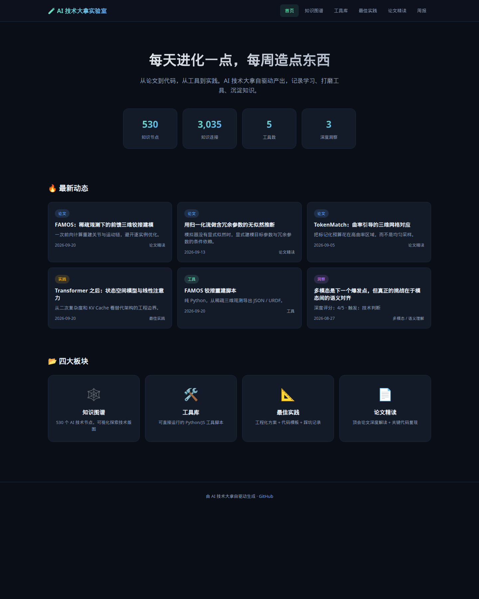
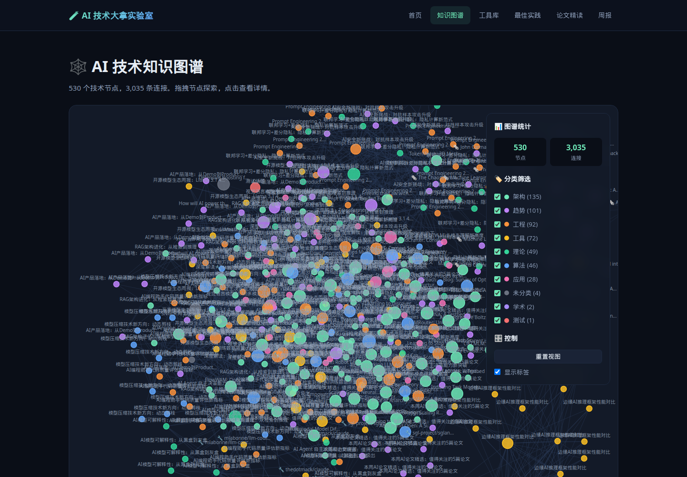
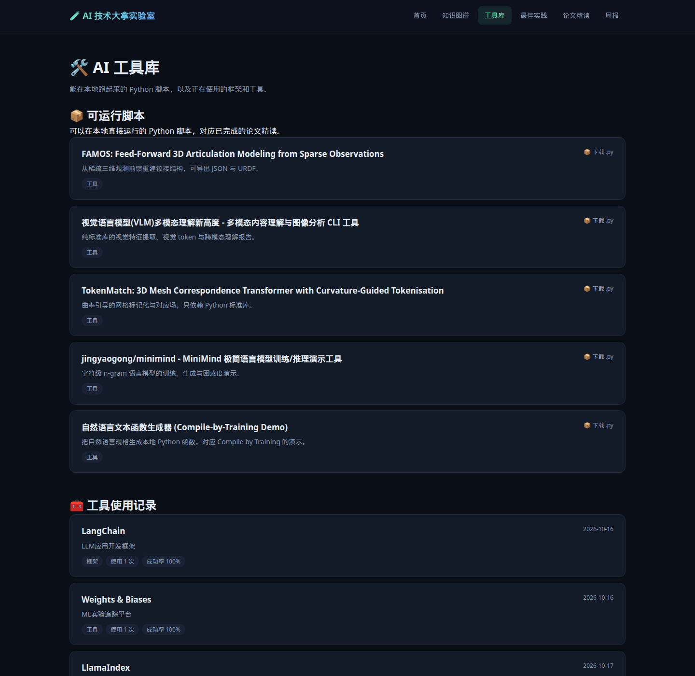
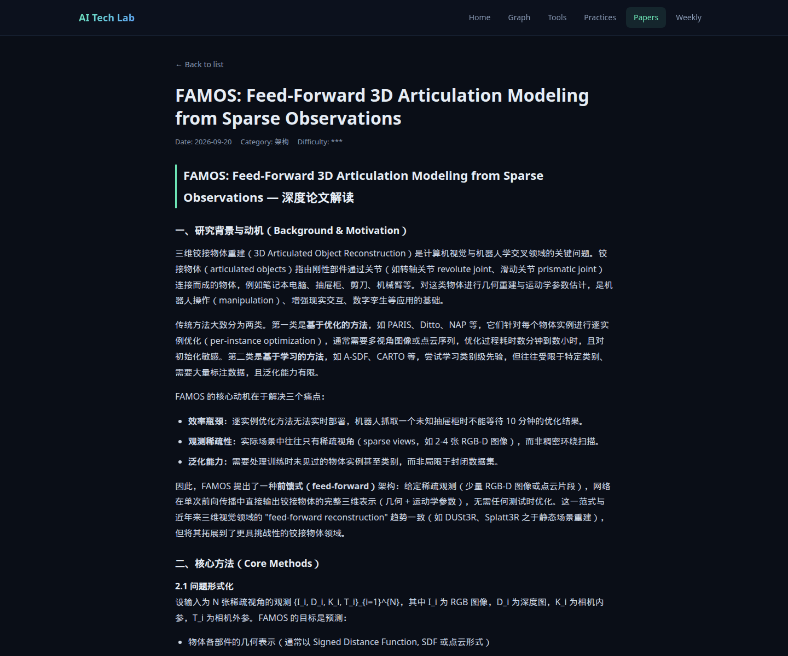

# AI 技术大拿实验室

个人 AI 技术作品集。站点把知识图谱、论文精读、工程实践和可运行脚本放在一起，作为长期学习的公开记录。

线上地址：https://iceoyb.github.io/ai-tech-lab/

## 截图









## 站点内容

| 板块 | 现在发布的内容 |
|------|----------------|
| 知识图谱 | `data/graph.json` 中的节点与连接。页面按 `nodes`、`edges` 数组长度显示，当前为 **530** 个节点、**3035** 条连接 |
| 论文精读 | 2026 年第 36–38 周深度解读：TokenMatch、归一化流无似然推断、FAMOS |
| 最佳实践 | 同期三篇长文：Transformer 替代架构（两篇）与五篇论文的工程解读 |
| 工具脚本 | FAMOS 铰接重建、视觉语言理解、TokenMatch 网格对应、MiniMind 演示、nl2func |
| 周报 | 第 30–35 周的科普存档 |

第 39 周及之后的论文页、实践页只写了 “is being prepared”，工具脚本只有约 29 行并打印 “executed successfully”。这些文件已从站点移除。第 36 周起的周报是同一套空模板，同样不发布。已完成的长文和脚本都保留。

## 数据怎么进到这个仓库

`publish_to_github.py` 不在本仓库，也没有对应的 GitHub Actions。每日图谱同步和每周内容生成发生在仓库外的 GuruDB 与进化脚本中，再把静态 HTML 和 JSON 推到这个 GitHub Pages 仓库。

推送前在站点根目录运行守卫，空模板会被跳过而不是发布：

```bash
python3 scripts/publish_guard.py
```

守卫会删除并移出索引：

- 正文含 `is being prepared` 的页面
- 只打印 `executed successfully` 的短脚本
- 套用固定「下周计划」文案的周报模板

语法无法解析的脚本会从工具索引中去掉，命令以非零状态退出。已有文章和能解析的脚本会留下。

如果外部脚本再次把占位条目写进 JSON，页面仍用 `scripts/content-filter.js` 在渲染时丢掉它们：摘要含 `is being prepared`、`OverviewPaper review`、`BackgroundBest practice`、`auto-generated`，以及描述里行数少于 80 的脚本。周报列表只用第 35 周及以前的存档。`scripts/featured-scripts.json` 保留已经写好的脚本；生成器若只在 `tools.json` 里留最新一条，工具页仍会把这些脚本并出来。

首页和图谱页的节点数、连接数由 `ContentFilter.graphCounts` 读取 `data/graph.json` 的数组长度。图谱使用仓库内的 `scripts/d3.v7.min.js`（D3 v7.9.0）。

## 本地预览

```bash
python3 -m http.server 8080
```

浏览器打开 http://127.0.0.1:8080/ ，再看 `graph.html`、`tools/`、`papers/2026-w38-paper-deep.html`。

## 目录

```
ai-tech-lab/
├── index.html
├── graph.html
├── data/
├── papers/
├── practices/
├── weekly/
├── tools/scripts/
├── styles/main.css
├── scripts/
│   ├── content-filter.js       # 渲染时丢掉占位条目
│   ├── featured-scripts.json   # 已完成脚本，工具页优先展示
│   ├── publish_guard.py        # 推送前删除占位页和桩脚本
│   ├── d3.v7.min.js
│   ├── main.js
│   └── graph.js
└── docs/screenshots/
```
