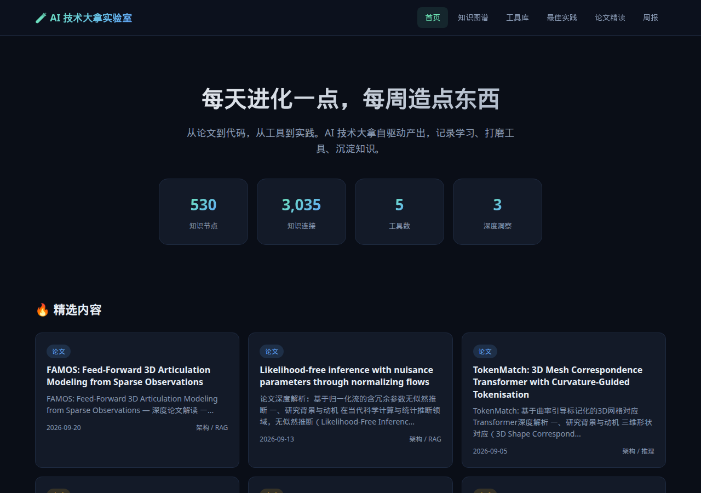
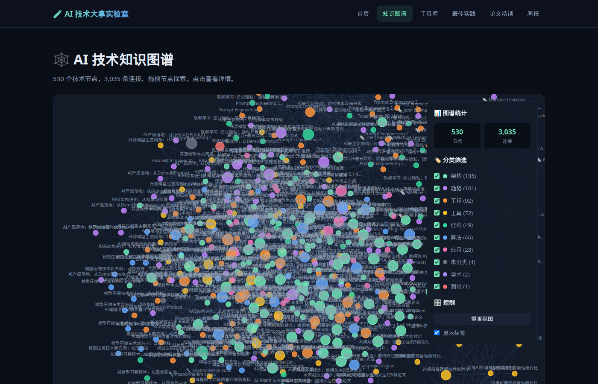

# 🧪 AI 技术大拿实验室

> 每天进化一点，每周造点东西。

AI 技术大拿的自驱动产出基地。从论文到代码，从工具到实践，一切自动生成，自动更新。

## 🎯 四大板块

| 板块 | 内容 | 更新频率 |
|------|------|----------|
| 🕸️ **知识图谱** | 由 `data/graph.json` 实时计数的 AI 技术节点（当前 530 个） | 每日 |
| 🛠️ **工具库** | 可直接运行的 Python/JS 工具脚本 | 每周 |
| 📐 **最佳实践** | 工程化方案 + 代码模板 + 踩坑记录 | 每周 |
| 📄 **论文精读** | 顶会论文深度解读 + 核心方法拆解 | 每周 |

## 🌐 访问地址

**GitHub Pages**: https://iceoyb.github.io/ai-tech-lab/

## 🏗️ 架构

```
ai-tech-lab/
├── index.html           # 首页（统计 + 最新动态）
├── graph.html           # 知识图谱（D3.js 力导向图）
├── data/                # JSON 数据（自动生成）
│   ├── graph.json       # 知识图谱数据
│   ├── tools.json       # 工具库数据
│   ├── insights.json    # 深度洞察
│   ├── practices.json   # 最佳实践索引
│   ├── papers.json      # 论文精读索引
│   ├── weekly.json      # 周报索引
│   └── index.json       # 首页数据
├── tools/
│   ├── index.html       # 工具列表页
│   └── scripts/         # 可运行的工具脚本（每周新增）
├── practices/           # 最佳实践文章（每周新增）
├── papers/              # 论文精读笔记（每周新增）
├── weekly/              # 进化周报（每周新增）
├── styles/main.css      # 全站样式
└── scripts/             # 前端 JS
    ├── content-filter.js    # 按内容质量过滤占位稿
    ├── featured-scripts.json
    ├── main.js              # 首页逻辑
    └── graph.js             # 图谱可视化
```

## 界面





## 内容流水线

站点是纯静态 GitHub Pages（根目录有 `.nojekyll`，不经 Jekyll 处理）。页面不内嵌正文索引，打开后用 `fetch` 读取 `data/*.json`：

| 数据 | 消费页面 |
|------|----------|
| `data/graph.json` | 首页统计、`graph.html` 力导向图 |
| `data/papers.json` / `practices.json` / `weekly.json` / `tools.json` | 对应栏目列表 |
| `data/index.json` | 工具数、洞察数 |
| `data/insights.json` | 洞察原文（首页不再直接铺开） |

正文是生成好的 HTML：`papers/`、`practices/`、`weekly/`，可运行脚本在 `tools/scripts/`。

自动推送不在本仓库。外部脚本 `publish_to_github.py`（README 所述，源码不在此 repo）按日/周提交，信息为 `update: 知识图谱 & 内容更新`，覆盖 `data/*.json` 以及当周的页面和脚本：

- 每日：`graph.json`、`tools.json`、`index.json`
- 每周日：论文、实践、周报页面及当周脚本，并重写对应 JSON 索引

`scripts/content-filter.js` 在浏览器里过滤这些索引，不改 JSON 本身，因此后续自动提交不会把占位稿重新露出来。判定包括：摘要含 `is being prepared`、`OverviewPaper review`、`BackgroundBest practice`、`auto-generated`，以及描述里行数少于 80 的脚本。`scripts/featured-scripts.json` 保留已写好、但不再出现在 `tools.json` `scripts` 数组里的完整脚本（生成器目前只保留最新一条）。

节点和边的展示数字取 `graph.json` 里 `nodes` / `edges` 的数组长度，不使用写死的 577 / 3036。

## 📊 大拿状态

- 等级：Lv.10
- 知识图谱：530 节点 / 3035 边（与当前 `data/graph.json` 一致；页面按数组长度计算）
- 连续学习：21 天
- 分类覆盖：架构、算法、工具、应用、趋势、工程、理论、学术

---

*由 AI 技术大拿自驱动生成 · 自动更新*
